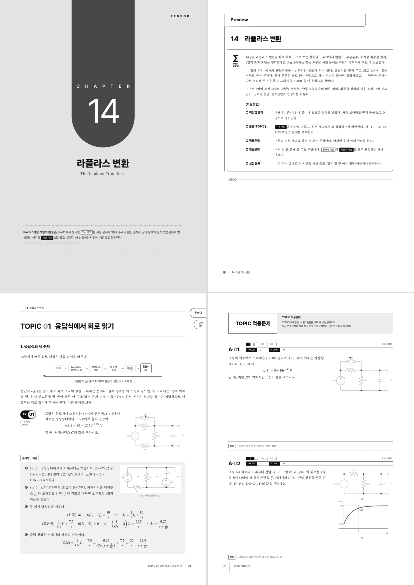
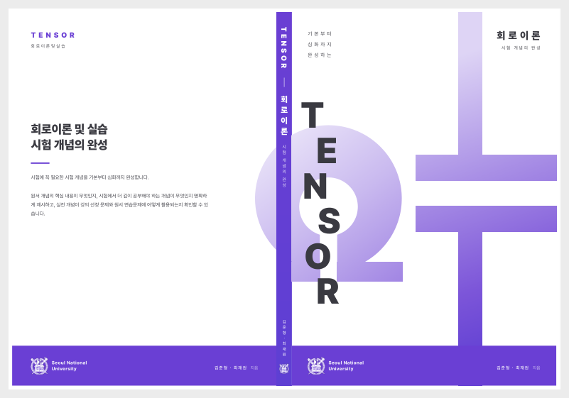

# TENSOR 교재 제작

강의록과 원서 PDF를 첨부하고 사용하는 도구에 맞는 프롬프트를 복사하세요. 원고는 JSON 으로 쓰고 `tensor/scripts/build.py` 가 고정 부품으로 조판하므로 Claude 와 Codex 가 같은 모양의 책을 만듭니다.

**Claude**

```text
https://github.com/legojmon/tensor-textbook-skill 저장소의 tensor/SKILL.md를 읽고 첨부한 강의록과 원서로 TENSOR 교재를 만들어줘. 저장소를 열 수 없으면 dist/tensor.zip을 요청해. 같은 스킬의 setup.py와 selfcheck.py로 조판을 확인하고, 자료 누락과 시험 범위를 짚고 TOPIC 구성안을 보여줘. 내가 확인하면 JSON 원고를 build.py로 조판해 내지와 앞·뒤표지, 책등, 펼침면 PDF를 만들어줘. 책 전체를 만들 때는 저자 원고와 사진을 받아 서문과 전체 차례도 넣어줘.
```

**Codex** · 이 저장소를 프로젝트로 연 뒤 사용하세요.

```text
$tensor 첨부한 강의록과 원서로 TENSOR 교재를 만들어줘. 견본 조판을 확인하고 TOPIC 구성표를 이 대화에 보여줘. 범위나 구성에서 내가 선택할 부분은 Codex 질문 카드로 물어봐. 한 TOPIC 시안을 선택하면 JSON 원고를 build.py로 조판한 시안 PDF를 여기서 열어볼 수 있게 줘. 전체 제작을 진행하면 build·lint·render 검사를 모두 통과한 내지와 앞·뒤표지, 책등, 펼침면 PDF도 여기에 줘. 책 전체를 만들 때는 저자 원고와 사진을 받아 서문과 전체 차례도 넣어줘.
```

## 데모

[회로이론 14장 내지 PDF](examples/demo/demo.pdf) · 라플라스 변환, 자체 제작 예제와 연습문제 · 원고 [example-manuscript.json](tensor/references/example-manuscript.json)



[표지와 책등 펼침면 PDF](examples/demo/cover/spread.pdf)



[공동 서문·저자 소개·전체 차례가 있는 회로이론 견본](examples/opening/book.pdf) · [뒷표지 소개 글](examples/opening/back.pdf) · [두 저자가 작성할 원고](tensor/assets/authors/author-workbook.md)

## 어떻게 같은 모양이 나오나

1. 모델은 `work/book.json` 에 글만 쓴다 (형식: [manuscript-schema.md](tensor/references/manuscript-schema.md)).
2. `python tensor/scripts/build.py work/book.json` 이 장 표지·목차·Preview·강의 선정 문제·TOPIC 부품(EX, 원서적·시험적 해법, 말풍선, 3탭 개념 박스, CORE, TIP, 채점 포인트, 강의 VS 연습문제 표)·적용문제·연습문제·Review·빠른 정답을 고정 HTML/CSS 로 조립한다. 필수 부품·순서·분량·그림·출처·정답이 빠지면 파일을 쓰지 않는다.
3. `lint.py` 가 문체·번호·구조를, `render.py --strict` 가 넘침·수식·그림 오류를 잡는다. 셋 다 0 이어야 전달한다.

<details>
<summary>처음 설치하거나 같은 원고의 조판 결과를 확인할 때</summary>

Python 3.12와 Node.js/npm을 준비한 뒤 저장소 루트에서 실행하세요. Windows·macOS·Linux에서 같은 Python 진입점을 사용합니다. macOS·Linux에서 Python 실행 파일이 `python3`이면 아래 명령의 `python`을 바꾸세요.

```sh
python tensor/scripts/setup.py
python tensor/scripts/selfcheck.py
```

`selfcheck.py`는 견본 원고 JSON 을 `build.py` 로 조립하고 `lint.py` 를 거쳐 PDF로 만든 뒤 기준 이미지와 쪽별로 비교합니다. 용지 크기와 쪽수가 같고, 각 쪽에서 명암 차이가 16/255를 넘는 픽셀이 2% 이하여야 통과합니다. 조판 규칙을 의도적으로 바꾼 뒤에는 `python tools/refresh_demo.py` 로 데모 PDF·기준 이미지·미리보기를 다시 만듭니다.

저자와 과목 입력 양식은 [앞부분 작성 지침](tensor/references/frontmatter.md)에 있습니다. Claude에 직접 가져오려면 [배포용 스킬](dist/tensor.zip)을 사용하세요 (`python tools/package_skill.py` 로 갱신).

</details>

원서와 강의 자료로 만든 교재는 개인 학습용으로 사용하세요. 서울대학교 로고는 학교 규정에 따라 사용하세요. 표지 설계 김준형 · 최재원. 코드 MIT License.
