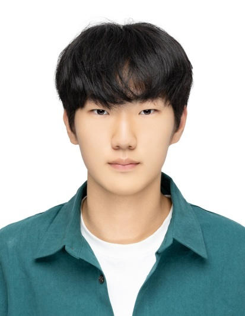

# TENSOR 저자

| | 최재원 | 김준형 |
|---|---|---|
| 소속 | 서울대학교 전기정보공학부 25학번 | 서울대학교 전기정보공학부 25학번 |
| 이력 | 전기정보공학부 25학번 룰루반 과대표 · TENSOR 기획·집필 | 전기정보공학부 학생회 복지부 팀장 · TENSOR 공동 집필·표지 설계 |
| 사진 |  | 넣지 않음 (글만) |
| 일러스트 |  사진 모서리에 작은 동그라미 프로필로 | 없음 |

`authors.json` 하나에 두 사람의 정보가 모두 들어 있다. 교재를 만들 때 `frontmatter.py --authors author/authors.json` 으로 쓰인다.
값이 **괄호로 시작하면 빈 칸**이라 책에 들어가지 않는다. 사진이 없으면 사진 자리를 비우지 않고 글만 넣는다.

## 진행 상황

| 번호 | 항목 | 칸 | 최재원 | 김준형 |
|---|---|---|---|---|
| ① | 이름 · 영문 이름 · 소속 | `name`, `name_en`, `bio` | 완료 | 완료 |
| ② | 이력 · 소개하고 싶은 경험 (사실만, 한 줄씩) | `bio` | 과대표·기획 완료, 경험 1줄 더 받을 수 있음 | 학생회 복지부 팀장 완료 |
| ③ | 이 과목에서 실제로 막혔던 한 장면 | `scene` | 비어 있음 (선택) | 비어 있음 (선택) |
| ④ | 독자에게 해 주고 싶은 말 1~2문장 | `message` | 초안 | 초안 |
| ⑤ | 이 책을 만들면서 특히 신경 쓴 부분과 이유 | `intro` | 초안 | 초안 |
| ⑥ | 증명사진 | `photo` | 완료 | 넣지 않음 |
| ⑦ | 일러스트 | `avatar` | 완료 | 없음 |
| ⑧ | 서명 | `signature` | 없음 | 없음 |
| - | TENSOR 공통 서문 | `preface` | 초안 (두 사람 확인 필요) | |

초안은 최재원이 밝힌 제작 취지(개념 중심, 원서를 볼 때의 불편함, "원서에 없는데 문제에 나오는 개념")로 쓴 글이다. 고칠 곳이 있으면 `authors.json` 의 해당 칸을 바꾸고 다시 렌더링한다.

공통 칸: 질문 창구(`contact.질문`), 다음 과목 계획(`series`).

### 쓸 때 지킬 것
- ③은 실제로 겪은 장면만 쓴다. 문제 번호나 장 번호가 있으면 더 좋다. 비어 있으면 그 칸은 책에서 빠진다.
- 이력은 꾸미지 않는다. 확인할 수 있는 사실만 쓴다.
- 문장은 평서문(~다)으로 쓴다. 줄표(—)와 느낌표, "최고의", "완벽한" 같은 광고 문구는 쓰지 않는다.
- 학번 뒷자리, 전화번호처럼 공개되면 곤란한 정보는 넣지 않는다. 이 폴더는 공개 레포에 있다.
